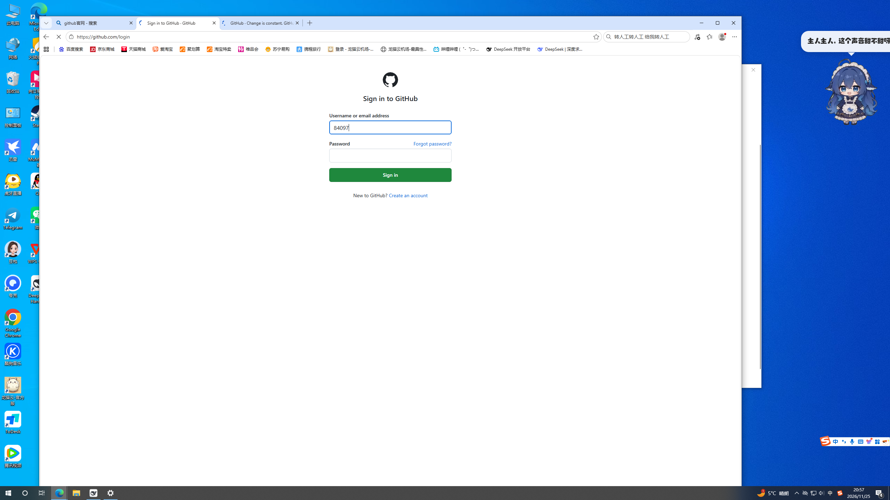

# dsh-pet-sound 🎐

给 [@tuweizhi/dsh-pet](https://www.npmjs.com/package/@tuweizhi/dsh-pet)（DSH 桌面宠物插件）补上**声音系统**：
事件音效 + 中文语音朗读，带四级自动降级。

> 原插件完全没有音频代码——零音频素材、零 `Audio` 调用、两个 `<video>` 全程 muted。
> 这套是从零接上去的，不修改原插件任何一行逻辑（用原型包装挂接）。



## 特性

- **音效**（Web Audio 现场合成，无需 mp3/wav 素材）：点击、拖拽起手、落地、甩出、气泡弹出、余额、报错
- **语音朗读**：把气泡里的文字念出来，四级自动降级
  1. OneCore 常驻进程（Yaoyao / Huihui / Kangkang，最自然）
  2. SAPI 直连（Huihui）
  3. Chromium `speechSynthesis`
  4. 宠物电子音（按字 blip，纯 Web Audio，**保证出声**）
- **可调**：音色、语速、音调、音量、逐项音效开关、念哪些内容
- **不拖累渲染**：所有音频异常都被捕获并记账，不会影响宠物动画/拖拽/气泡
- **可重打**：插件升级后跑一次 `apply-sound.ps1` 即可恢复（幂等）

## 安装

前置：已安装 `@tuweizhi/dsh-pet`，且桌宠 `display` 含 `desktop`。

```powershell
# 把本仓库文件放到任意目录，然后：
powershell -ExecutionPolicy Bypass -File apply-sound.ps1 -Restart
```

脚本会（幂等）：

1. 复制 `sound.js` / `sound-hooks.js` / `sound-onecore.ps1` 到插件的 `runtime/electron-helper/`
2. 在 `index.html` 里补两个 `<script>`（已存在则跳过）
3. 在 `preload.js` 末尾补 `petSoundBridge`（已存在则整块更新）
4. 首次安装时写入 `~/.dsh/dsh-pet/sound.jsonc`（已存在则不覆盖）
5. `-Restart` 时重启宠物窗口（宿主会自动拉起）

`-Status` 只看安装状态。

## 让它说话

```powershell
powershell -ExecutionPolicy Bypass -File say.ps1 -Text "主人，我饿啦"
```

走宿主 `POST /dsh-pet-7340/broadcast` 投喂一句，宠物会冒气泡并朗读。
（`-Port` 默认 53246，按你 DSH 网页的实际端口改。）

## 配置

`~/.dsh/dsh-pet/sound.jsonc`，改完右键宠物「重载配置」。

```jsonc
{
  "enabled": true,
  "volume": 0.8,
  "sfx": { "enabled": true, "volume": 1, "click": true, "dragStart": true, "drop": true, "throw": true, "bubble": true, "whisper": true, "balance": true, "error": true },
  "voice": {
    "mode": "auto",            // auto / onecore / sapi / tts / blip
    "onecoreVoice": "Yaoyao",  // Yaoyao 甜 / Huihui 成熟 / Kangkang 男声
    "rate": 1.0,               // 语速 0.5~2
    "pitch": 1.15,             // 音调 0.5~2.5（OneCore 下转 SSML pitch，每 0.1 ≈ +8Hz）
    "volume": 0.9,
    "speakBubble": true,       // 气泡文字要不要念
    "speakBalance": false,
    "speakClick": false,
    "maxChars": 120
  },
  "log": false
}
```

字段缺失或类型写错都不会崩，非法值回落到内置默认。

## 工作原理

```
气泡出现 ──► sound-hooks.js（包装 PetSprite 原型方法）
                │
                ├─ 音效 ──► sound.js Web Audio 合成
                └─ 朗读 ──► sound.js 按优先级选引擎
                              ├─ 1. Edge 在线神经语音（127.0.0.1:9881，零显存）
                              ├─ 2. CosyVoice2 本地服务（127.0.0.1:9880）
                              ├─ 3. OneCore：sound-onecore.ps1 常驻进程（WinRT + SoundPlayer）
                              ├─ 4. SAPI：PowerShell + SAPI.SpVoice
                              ├─ 5. Chromium speechSynthesis
                              └─ 6. 兜底：Web Audio blip（按字发音，永不哑）
```

前一层探测或调用失败会自动降级到下一层；`voice.mode` 可以强制指定只用某一层。

### Edge 神经语音（默认首选）

微软 Edge 的在线神经语音（`edge-tts`），**原生合成、零显存**，本地只跑一个 60MB 转发服务。
见 **[edge/](edge/README.md)**：

```powershell
powershell -ExecutionPolicy Bypass -File D:\ai\edge\edge-start.ps1
```

实测：显存占用比 CosyVoice 方案少 **3.8 GB**，可用内存多 **5.9 GB**，单句延迟 1.7~2.4 秒。
默认音色 `zh-CN-XiaoyiNeural`（晓伊）+25Hz。

> 为什么有了 CosyVoice 还要 Edge：CosyVoice 是**克隆参考音**，
> 参考音若是合成音，克隆结果会带机械感。Edge 是原生合成，没有这层损耗。

### CosyVoice2 引擎（离线后备）

CosyVoice2-0.5B 是本地跑的中文 TTS，**没有内置音色**，靠一段参考音做零样本迁移。
本仓库附带完整安装脚本与服务代码，见 **[cosyvoice/](cosyvoice/README.md)**：

```powershell
powershell -ExecutionPolicy Bypass -File D:\ai\cosy\cosy-start.ps1
```

实测：显存约 2.5GB，单句 1.4~2.3 秒，输出 F0 约 300Hz（少女向）。
服务没起时桌宠自动降级，不影响使用。

接线点（全部是包装，不改原文件）：

| 方法 | 触发 |
| --- | --- |
| `showWhisper` | 碎碎念 / 对话回复 / 第三方投喂 → 气泡音 + 朗读 |
| `showBalanceNow` | 余额气泡 |
| `onClick` | 点击回应 |
| `onPointerMove` | `dragState.dragging` 翻真那一帧 → 起手音（只响一次） |
| `onPointerUp` | 松手：有初速=甩出，无初速=放下 |
| `startThrow` / `startSquash` | 标记飞行 + 落地首次挤压 → 落地音 |
| `dispose` | 停朗读、释放音频 |

## 为什么语音要绕开浏览器

在某些 Electron 环境下 `speechSynthesis.getVoices()` 返回 **0 个语音**，但系统语音引擎本身是可用的
（SAPI 能枚举 Huihui/Zira，OneCore 能拿到 Huihui/Yaoyao/Kangkang）。
所以真人声走外部引擎，不经过 Chromium。

> **踩坑记录**：用沙箱内的进程测 SAPI 会得到 `E_ACCESSDENIED` / `0x80045040`，
> 那是沙箱拿不到音频端点造成的假象，不代表引擎坏了。判断语音可用性必须在
> **宠物自己的渲染进程**里做——诊断日志由它直接回写，不依赖外部推测。

## 排障

看 `~/.dsh/dsh-pet/sound-diag.log`（每次启动、每次发声各一行 JSON）：

| 日志 | 含义 |
| --- | --- |
| `probe ... count:0` | Chromium 看不到语音（不影响外部引擎） |
| `oc-probe ok:true voice:Microsoft Yaoyao` | OneCore 就绪 |
| `oc-ok` / `oc-err` / `oc-exit` | OneCore 念出 / 合成失败 / 进程退出 |
| `sapi-probe ok:true` | SAPI 可用 |
| `sapi-ok` / `sapi-exit code:N` | SAPI 念出 / 失败（`err` 带 PowerShell 报错） |

## 自测

```powershell
$env:ELECTRON_RUN_AS_NODE = "1"
& "$env:USERPROFILE\.dsh\electron\electron.exe" verify.js
```

在假 DOM + 假 WebAudio 环境里跑真实引擎，15 项断言（降级、看门狗、不叠音、拖拽只响一次、落地只响一次等）。

## 已知限制

- 只覆盖 `display` 含 `desktop` 的宠物窗口；网页 overlay 那半侧未接
- 工作状态气泡（"正在继续干活呢"这类）不发声，只处理 say 叶子
- OneCore 首句要等 WinRT 初始化（约 1~2 秒），之后每句只付合成时间
- SAPI 无音调参数，只有 OneCore 能靠 SSML 抬调
- 多宠物同屏时每个窗口各自持有音频上下文

## 许可

MIT（见 [LICENSE](LICENSE)）。本仓库不包含 `@tuweizhi/dsh-pet` 的任何代码，
仅在运行时对其做原型包装；该插件本身的许可见其包内 LICENSE。

